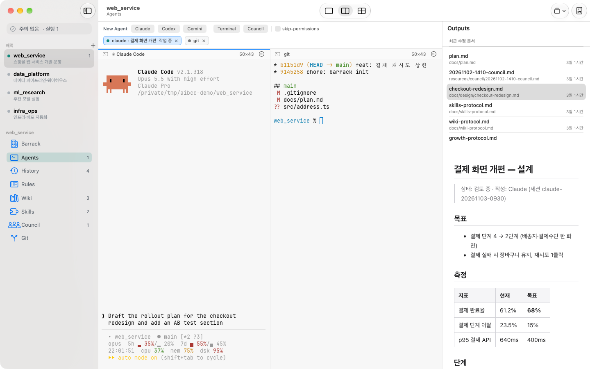
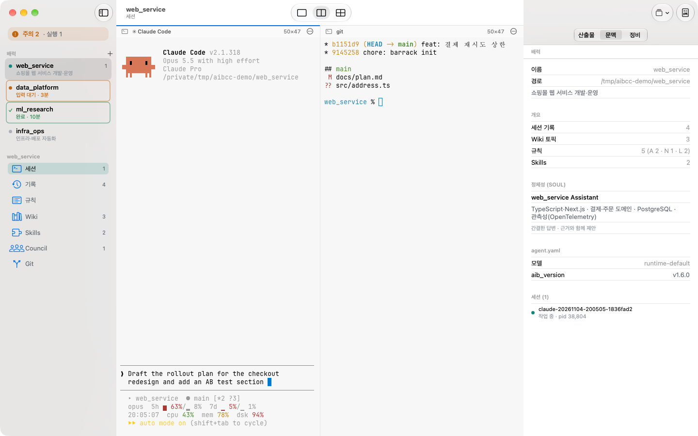
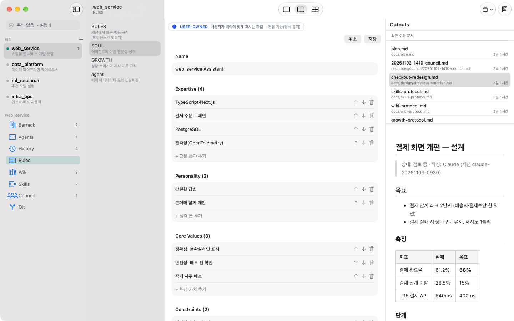
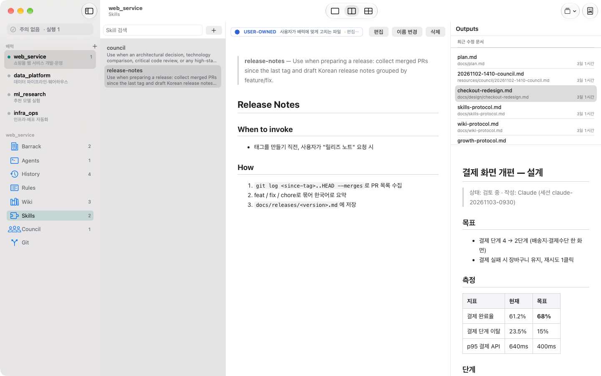
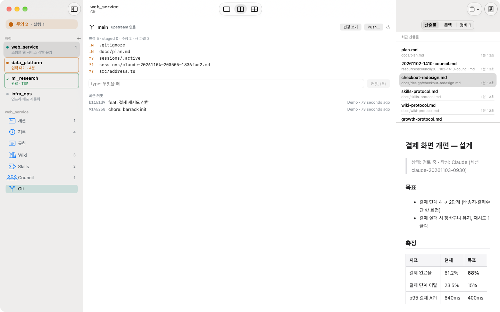
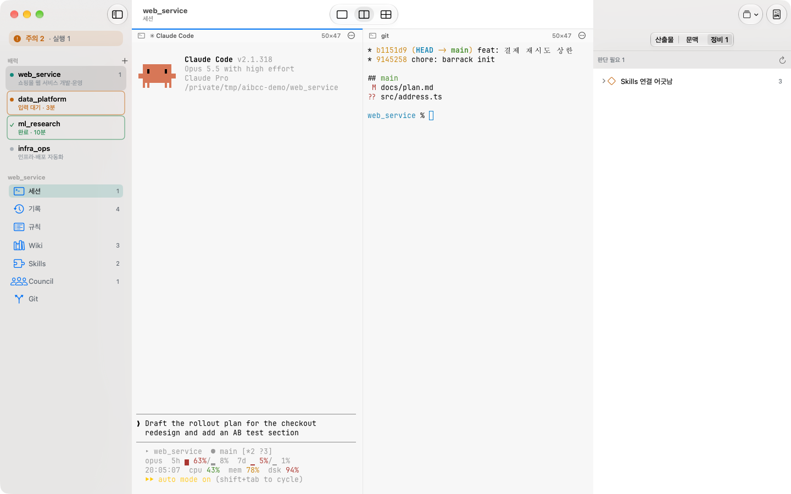
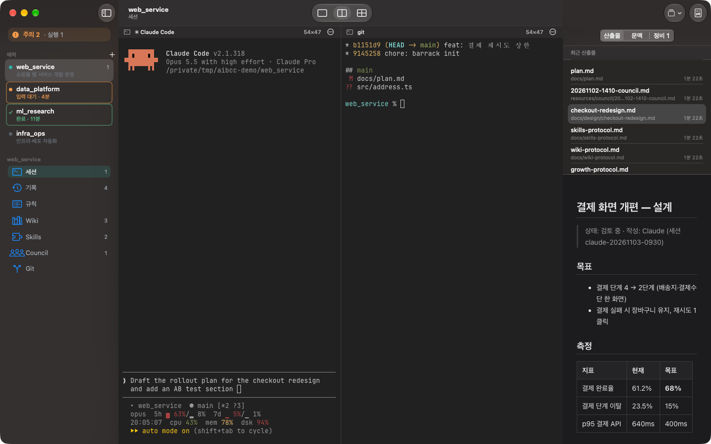

# AI Barracks CommandCenter 2 (beta)

[ai-barracks](https://github.com/ai-barracks/ai-barracks) 배럭을 관제하는 macOS 네이티브 앱. CommandCenter 1.x(Tauri, `main` 브랜치)를 Swift + [libghostty](https://github.com/Lakr233/libghostty-spm)로 다시 만든 v2로, v1 1.6.1의 기능을 모두 담고 있다.

> **베타**: v1과 나란히 설치해 비교하며 쓰는 단계다. 번들 ID가 다르므로(`com.aibarracks.commandcenter2`) 설정·세션이 v1과 섞이지 않는다. 자세한 상태는 [docs/RELEASE.md](docs/RELEASE.md)에 있다.



## 무엇이 다른가

- **터미널**: Ghostty 엔진 기반이다. 출력이 폭주하는 중에도 입력이 밀리지 않는다(입력 지연 p95: v1.6.1 240 ms, v2 16.7 ms). 리사이즈해도 줄·열이 잘리지 않고, 1·2·4 분할을 지원한다.
- **세션 유지**: 터미널은 별도 PTY 데몬이 소유한다. 앱을 끄거나 다시 켜도 에이전트 세션이 살아 있고, 다시 붙으면 이전 화면을 재생한다.
- **배럭 문서**: RULES·SOUL·GROWTH·agent.yaml을 폼으로 편집한다. 바깥에서 동시에 수정한 경우 섹션 단위로 병합한다. Wiki·세션 기록·Skills도 편집할 수 있다.
- **운영**: 정비 큐(배럭별 할 일), ⌘K 팔레트, Git(배럭 경로만 커밋), Council, 새 에이전트(⌘N), 배럭 추가, 터미널 출력 보관, 모델 프로필, 예약 활성화(v1과 같은 파일·잠금을 써서 이중 실행 없음), v1 설정 가져오기.

| | |
|---|---|
|  |  |
|  |  |
|  |  |

전체 화면 목록은 [docs/screenshots/](docs/screenshots/)에 있다.

## 설치

1. [Releases](https://github.com/ai-barracks/ai-barracks-cc/releases)에서 `v2.*` 의 `AI-Barracks-CommandCenter-*.dmg`를 받아 앱을 `/Applications`로 끌어 놓는다.
2. ad-hoc 서명(공증 없음)이라 처음 한 번은 격리 속성을 지운다:
   ```bash
   xattr -cr "/Applications/AI Barracks CommandCenter 2.app"
   ```
3. 요구 사항: Apple Silicon Mac, macOS 14+, `aib` CLI 1.6.0+(`brew tap ai-barracks/ai-barracks && brew install ai-barracks`). Claude Code·Codex·Gemini CLI는 쓰는 것만 있으면 된다.

데이터 위치, v1과 함께 쓰기, 제거 방법은 [docs/INSTALL.md](docs/INSTALL.md)에 있다.

## 소스에서 빌드

Xcode 없이 Command Line Tools만으로 빌드한다.

```bash
VARIANT=release ./scripts/package-app.sh   # dist/release/AI Barracks CommandCenter 2.app
./scripts/make-dmg.sh                      # DMG + SHA-256
```

자체 테스트(`--selftest`), PTY 데몬 smoke, 앱 재실행 세션 유지 테스트, PoC 판정 기준은 [docs/DEVELOPMENT.md](docs/DEVELOPMENT.md)에 있다.
