# 🎛️ AI Barracks CommandCenter 2

*배럭이 하나일 땐 CLI로 충분합니다. 둘 이상이 되는 순간, CommandCenter가 필요합니다.*

[AI Barracks](https://github.com/ai-barracks/ai-barracks)(`aib`)의 배럭을 한 화면에서 관제하는 macOS 네이티브 앱입니다. 여러 배럭에서 Claude Code와 Codex를 동시에 띄우고, 누가 무엇을 하고 있는지와 누가 나를 기다리는지 보고, 에이전트가 남긴 기록과 산출물을 읽고 고칩니다.

> 스타크래프트의 Command Center처럼, Barracks에서 유닛(에이전트)을 생산하고 Command Center에서 모든 것을 관제합니다.

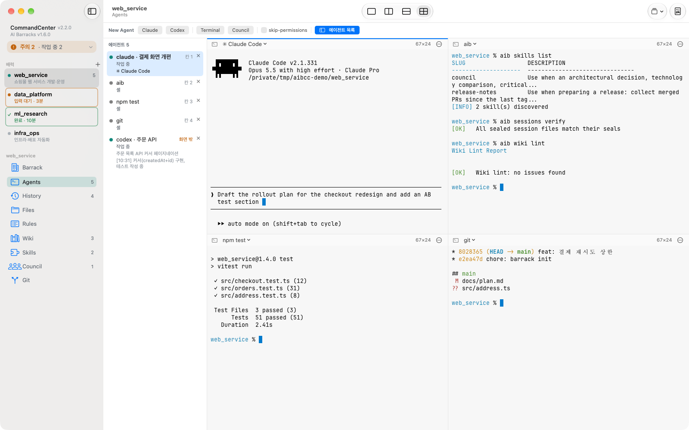

v2는 CommandCenter 1.x(Tauri + xterm.js)를 **Swift + [libghostty](https://github.com/ghostty-org/ghostty)** 로 처음부터 다시 만든 버전입니다. v1의 기능을 대부분 옮겼고(아직 일부만 옮긴 것은 아래 '알려진 제한'에 적었습니다), 터미널과 세션 유지를 새로 설계했습니다.

| | v1.6.1 | **v2** |
|---|---|---|
| 앱 | Tauri(Rust + React 웹뷰) | SwiftUI 네이티브 |
| 터미널 엔진 | xterm.js | Ghostty |
| 출력이 쏟아지는 중 키 입력 지연(p95) | 240 ms (10만 줄 출력 중) | **16.7 ms** (100만 줄 출력 중) |
| 앱을 끄면 | 터미널 종료(출력만 디스크에 보관) | **세션이 살아 있음** — 다시 켜면 그대로 이어짐 |
| 한 배럭의 터미널 | 최대 4개 | **제한 없음**(화면엔 1·2·4칸, 나머지는 화면 밖에서 계속 실행) |

---

## 🏰 AI Barracks가 뭔가요?

> **에이전트의 기억을 프롬프트가 아니라 Git 저장소에 남긴다.**

`aib`는 프로젝트 폴더 하나를 **배럭(Barrack)** 으로 만듭니다. 배럭 안에서 Claude Code를 띄우든 Codex를 띄우든 세션은 같은 규칙으로 기록되고, 에이전트는 같은 지식을 읽습니다. DB도 서버도 없이 마크다운 파일과 Git이 에이전트의 장기 기억이 됩니다.

```
my-project/                  ← 배럭 (aib init)
├── SOUL.md                  🖋️ 에이전트 정체성: 이름·전문성·성격·원칙 (사용자가 정의)
├── RULES.md                 ♻️ 행동 규칙: 세션에서 배운 것이 쌓임 (Must Always / Must Never / Learned)
├── GROWTH.md                🖋️ 성장 트리거: 무엇을 발견하면 어디에 기록할지
├── agent.yaml               🔒 배럭 메타데이터 (aib 관리)
├── sessions/                📝 세션 실록: 세션마다 Task·Log·Decisions·Blockers, 종료 시 봉인
│   └── .live/               🟢 지금 상태: 작업 중 / 입력 대기 / 완료 (Claude hook, Codex는 켠 경우 hook이 기록)
├── wiki/                    📚 장기 지식: Index.md만 읽고 필요한 토픽만 골라 로딩
├── skills/<slug>/SKILL.md   🧪 배럭의 능력 (Anthropic Agent Skills 호환)
└── resources/council/       🗳️ 여러 LLM이 토론한 의사록
```

세션이 시작되면 hook이 세션 파일을 만들고, 에이전트는 작업하면서 Log와 결정을 남기고, 새로 알게 된 것을 Wiki와 RULES로 옮깁니다. 다음 세션은 **다른 CLI라도** 그 기록을 읽고 이어 갑니다. 자세한 개념은 [AI Barracks](https://github.com/ai-barracks/ai-barracks) 저장소에 있습니다.

### CLI는 엔진, CommandCenter는 조종석

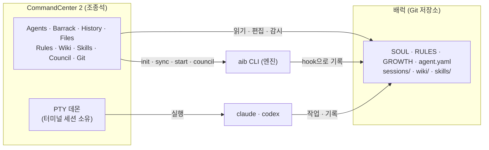

CommandCenter는 배럭 파일을 직접 읽고, 사람이 고쳐도 되는 파일만 고칩니다. 배럭 생성·동기화·세션 시작처럼 상태를 바꾸는 일은 항상 `aib`에 맡깁니다. 그래서 CLI를 업그레이드하면 앱도 같은 규칙을 따르고, 둘이 따로 노는 일이 없습니다.

| 하고 싶은 일 | CLI만 쓸 때 | CommandCenter에서 |
|---|---|---|
| 여러 배럭의 에이전트 상황 보기 | 배럭마다 `cd` 하고 세션 파일 확인 | 사이드바의 **주의 · 작업 중** 한 줄과 배럭별 터미널 수 |
| Claude·Codex 병렬 작업 | Terminal 창·탭을 손으로 정리 | 배럭마다 분할 작업면과 **에이전트 목록**. 배럭을 바꾸면 그 배럭의 터미널로 |
| 앱·터미널을 닫았다 다시 열기 | 세션이 끊김 | PTY 데몬이 세션을 쥐고 있어 **그대로 이어짐** |
| 에이전트가 만든 문서 읽기 | Finder·에디터를 따로 열기 | **Files**(트리 + md 뷰어·편집), **Outputs**(터미널 옆 최근 문서) |
| SOUL·RULES·GROWTH 고치기 | 형식과 ownership 마커를 손으로 지킴 | **폼 에디터**. 편집 중 에이전트가 같은 파일을 고치면 저장 전에 알려 줌 |
| "그때 그 결정 어디 있었지?" | 배럭마다 `grep` | **⌘K** 하나로 모든 배럭의 세션·Wiki·Rules 검색 |
| `brew upgrade` 뒤 템플릿 맞추기 | 배럭마다 `aib sync` | 버전 표를 보고 **골라서 Sync**(미리보기 포함) |

---

## ✨ 기능 둘러보기

> 아래 화면은 모두 데모 배럭([`scripts/make-demo.sh`](scripts/make-demo.sh))에서 찍었습니다. 터미널 속 Claude Code와 `aib`는 실제 프로그램이고, Claude에는 요청 문구를 입력만 하고 보내지 않았습니다.

### 🤖 Agents: 여러 에이전트를 한 작업면에서

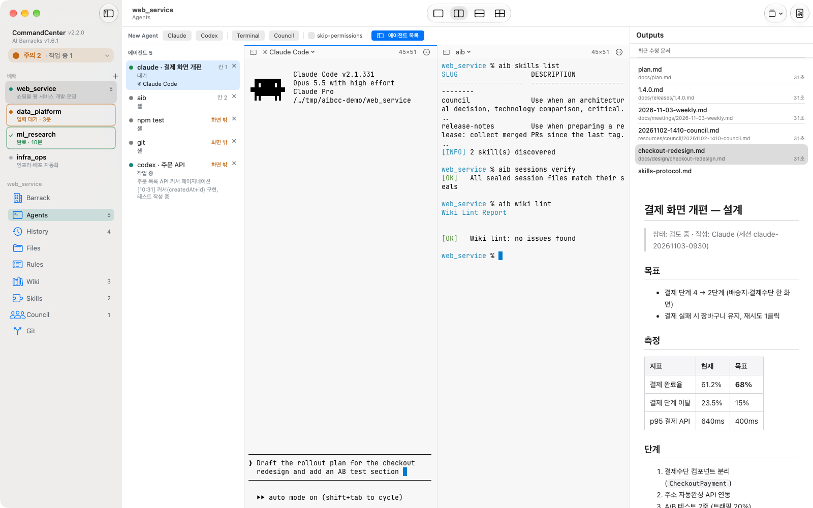

- **New Agent 막대**에서 Claude·Codex·Terminal·Council을 바로 시작합니다. 에이전트는 `aib start`로 실행되어 세션이 기록됩니다. `--skip-permissions`도 여기서 켜고, 모델은 설정의 모델 프로필이 새 세션에 적용됩니다.
- **분할**: 1칸 · 좌우 2칸 · 상하 2칸 · 4칸(⌘⌥1~4). 경계를 끌어 비율을 바꿉니다. 에이전트를 추가해도 분할은 사용자가 고른 대로 유지됩니다.
- **터미널 수 제한 없음**: 칸이 다 차면 새 터미널은 지금 칸에 뜨고, 밀린 터미널은 **화면 밖에서 계속 실행**됩니다. 칸 머리글의 제목을 누르면 그 칸에 보일 터미널을 고릅니다.
- **에이전트 목록**(왼쪽): 시작한 순서로 고정된 줄마다 상태 점, 에이전트가 화면 제목에 붙이는 작업 요약, aib 세션의 Task와 최근 Log, 칸 번호 또는 "화면 밖"이 보입니다(2초마다 갱신). 누르면 그 터미널로 갑니다.
- **Outputs**(오른쪽, ⌘⌥I): 배럭에서 최근 바뀐 문서를 터미널 옆에서 바로 렌더링해 봅니다.
- **세션 유지**: 터미널은 별도 PTY 데몬이 소유합니다. 앱을 끄거나 업데이트해도 에이전트는 계속 일하고, 다시 켜면 이전 화면을 재생한 뒤 이어 붙습니다. 닫은 터미널의 출력은 History → 터미널 출력에 보관됩니다.
- **Ghostty 터미널**: 출력이 쏟아지는 중에도 입력이 밀리지 않고, 창이나 칸 크기를 바꿔도 줄이 잘리지 않습니다. `aib start codex`가 쓰는 안쪽 터미널에도 크기 변경을 전달해 Codex 화면도 칸 크기를 따라갑니다. 한글 입력, ⌘V 붙여넣기, Quick Command, 출력 내보내기를 지원합니다.

### 🔔 주의 · 작업 중: 나를 기다리는 에이전트

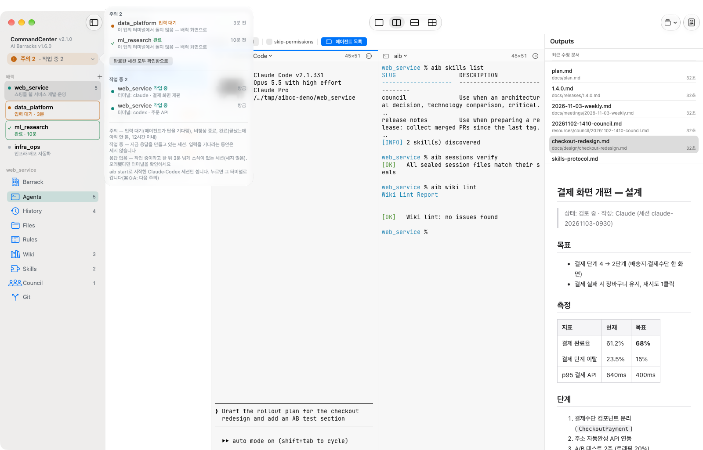

사이드바 맨 위 한 줄이 **모든 배럭**의 aib 세션 상태를 요약합니다. 누르면 세션 목록이 펼쳐지고, 줄을 누르면 그 터미널(없으면 그 배럭)로 갑니다. ⌘⇧A는 다음 주의 항목으로 갑니다.

| 구분 | 세는 것 |
|---|---|
| **주의** | 🟠 입력이나 승인을 기다리는 세션, 비정상 종료한 세션, 🟢 끝났는데 아직 확인하지 않은 세션(12시간 안) |
| **작업 중** | 🔵 지금 응답을 만들고 있는 세션 |
| 응답 없음 | 작업 중이었는데 3분 넘게 소식이 없는 세션(세지 않고 따로 표시) |

상태는 aib hook이 `sessions/.live/`에 남긴 기록과 프로세스 생존 여부로 판정합니다(`aib`와 같은 규칙). Claude Code는 `aib init`으로 hook이 걸리고, Codex는 `aib hooks codex install`로 켠 배럭에서만 상태가 보입니다. hook이 없는 세션은 세지 않습니다. 사이드바 위에는 CommandCenter와 `aib` 버전이, Agents 옆과 배럭 옆에는 열린 터미널 수가 표시됩니다. 메뉴 막대 아이콘에도 같은 요약이 나옵니다.

### 📁 Files: 배럭의 산출물을 Finder처럼

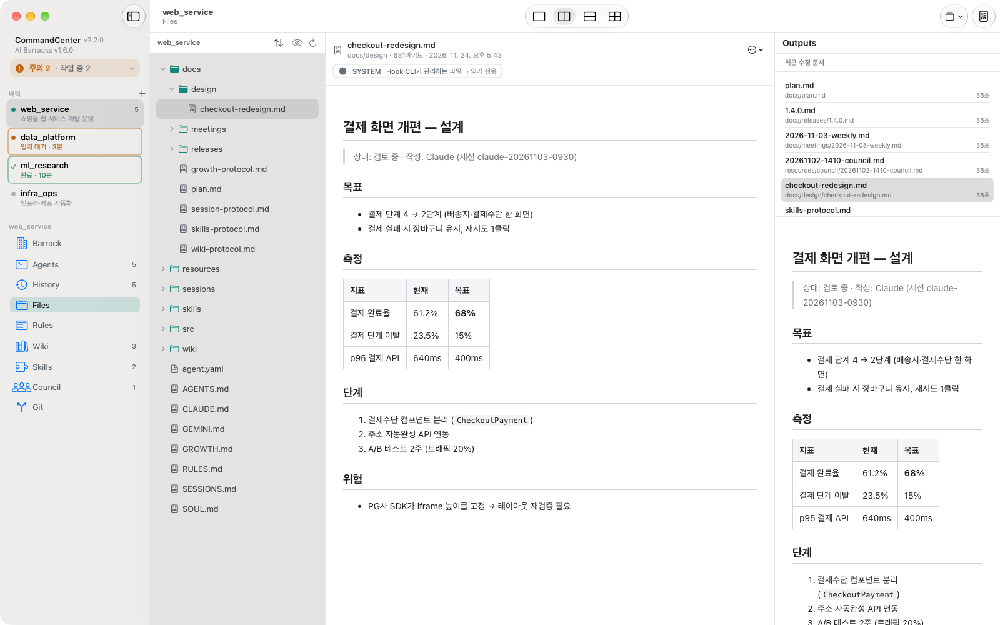

- 배럭 폴더를 트리로 봅니다. 폴더가 먼저 오고, 폴더는 클릭이나 →/←로 여닫습니다. 숨김 파일은 눈 아이콘으로 켭니다.
- 정렬: 이름 · 수정한 날짜 · 만든 날짜, 오름차순/내림차순.
- 고른 파일은 옆에서 엽니다. 마크다운은 렌더링(표·코드 포함), 텍스트와 코드는 원문, 이미지와 PDF는 미리보기로 보여 줍니다.
- 마크다운과 텍스트는 **편집(⌘E) → 저장(⌘S)** 합니다. 편집하는 동안 다른 곳에서 파일이 바뀌면 덮어쓰기 전에 묻습니다. aib가 관리하는 파일(세션 기록, `docs/`, Wiki, `RULES.md`)은 읽기 전용입니다.
- ⋯ 메뉴: Finder에서 보기, 기본 앱으로 열기, 경로 복사.

### 🗺️ Barrack: 배럭 한 장 요약과 정비

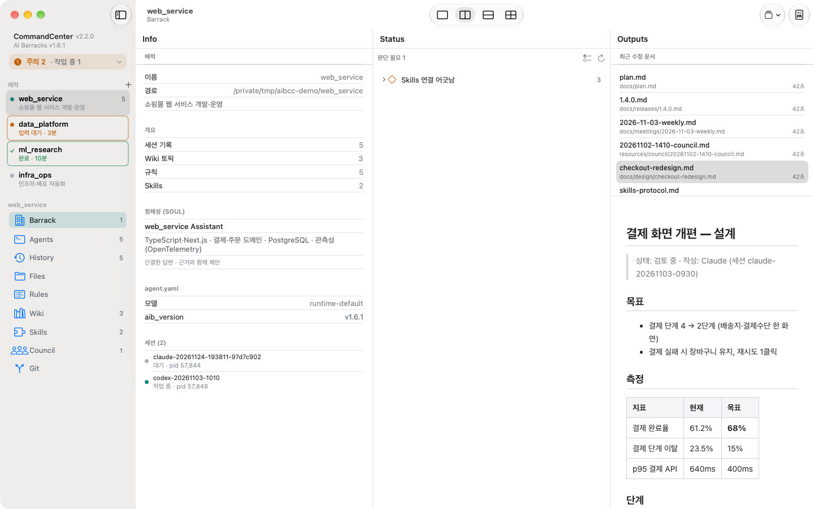

배럭 정보(설명, SOUL 요약, 세션·Wiki·규칙·Skills 수, aib 버전, 실행 중인 세션)와 상태 점검을 나란히 봅니다. 점검 항목은 봉인 뒤 바뀐 세션 기록, 빈 세션 파일, 죽은 상태 기록과 멈춘 세션, Wiki 경고, Skills 연결 어긋남, 배럭 프로토콜 버전입니다. 항목마다 그 자리에서 `aib` 명령으로 정리합니다. **배럭 골라서 Sync…**(⌘K)는 배럭별 버전 표를 보고 여러 배럭을 미리보기 후 한 번에 동기화합니다.

### 🔍 ⌘K: 모든 배럭을 한 번에 검색

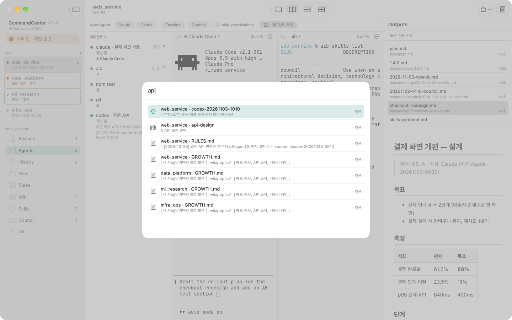

모든 배럭의 세션 기록·Wiki·Rules와 앱 명령(새 에이전트, Council, `aib sync`·`wiki lint`, 배럭 추가, git, Quick Command, 화면 이동)을 한 상자에서 찾습니다. 결과를 고르면 그 문서나 화면으로 바로 갑니다.

### 📜 History: 세션 실록과 터미널 출력

| 세션 기록 | 터미널 출력 보관 |
|---|---|
| 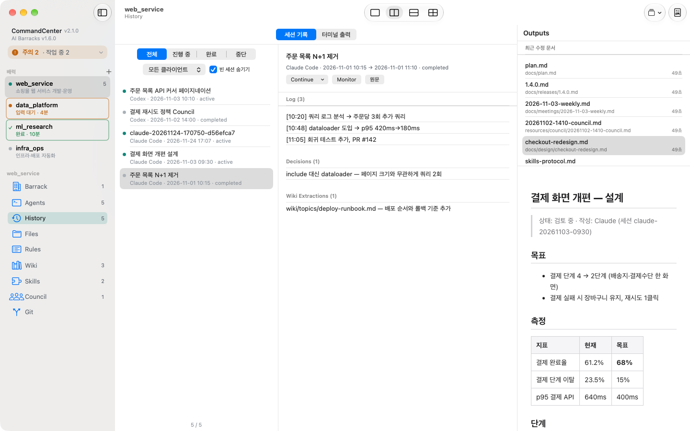 | 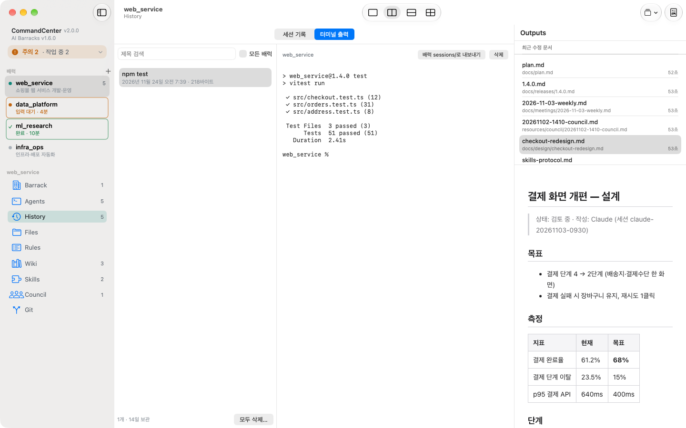 |

- 세션 파일을 Task · Log · Decisions · Wiki Extractions로 나눠 보여 줍니다. 상태와 클라이언트로 거르고, 빈 세션은 숨깁니다.
- **Continue**로 다른 CLI에서 그 세션을 이어받습니다(`aib hook continue`).
- 종료 뒤 봉인과 달라진 세션 파일에는 경고가 뜹니다(`aib sessions seal`로 승인).
- 닫은 터미널의 출력은 텍스트로 보관되어 다시 읽고 배럭 `sessions/`로 내보낼 수 있습니다(14일 보관).

### ✏️ Rules: 구조를 깨지 않는 편집

| RULES.md | SOUL.md |
|---|---|
| 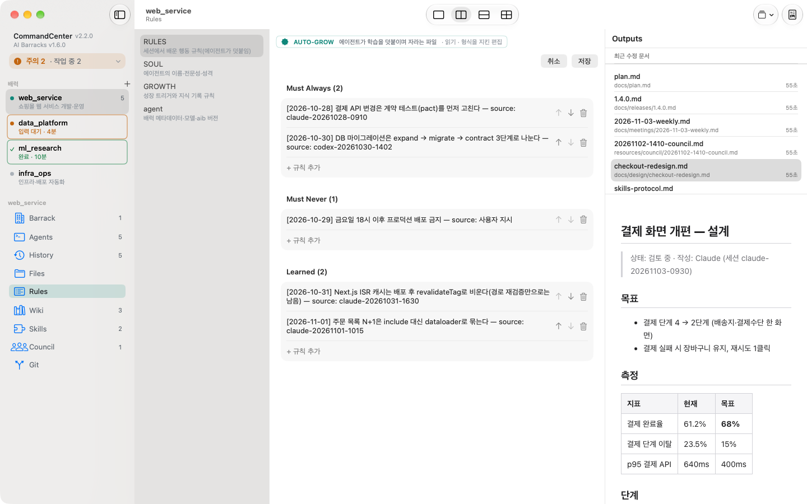 | 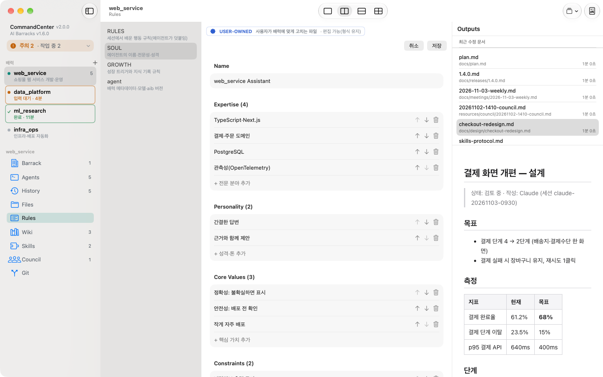 |

`RULES.md`·`SOUL.md`·`GROWTH.md`·`agent.yaml`을 파일 형식에 맞춘 **폼**으로 편집합니다. 상단 배너가 파일의 ownership(직접 편집 / 자동 축적 / aib 관리)을 알려 주고, 저장하면 aib가 기대하는 마크다운 형식으로 돌아갑니다. 편집 중에 에이전트가 같은 파일을 고쳤다면 저장 전에 알려 주고, **내가 바꾼 섹션만 새 내용에 적용**해 양쪽 변경을 모두 남길 수 있습니다.

### 📚 Wiki · 🗳️ Council · 🧪 Skills · 🌿 Git

| Wiki | Council |
|---|---|
| 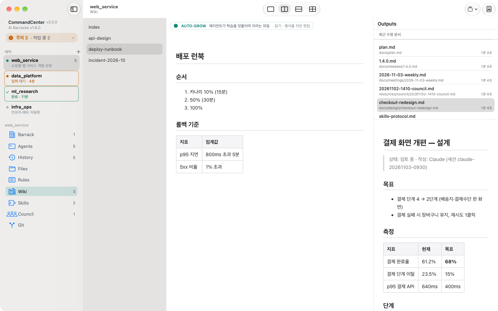 | 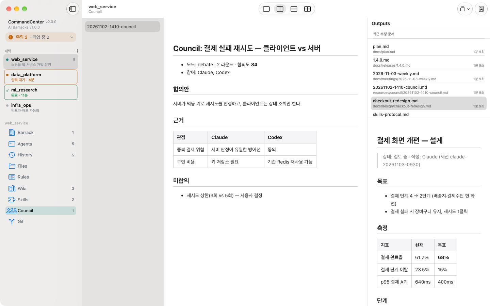 |
| **Skills** | **Git** |
| 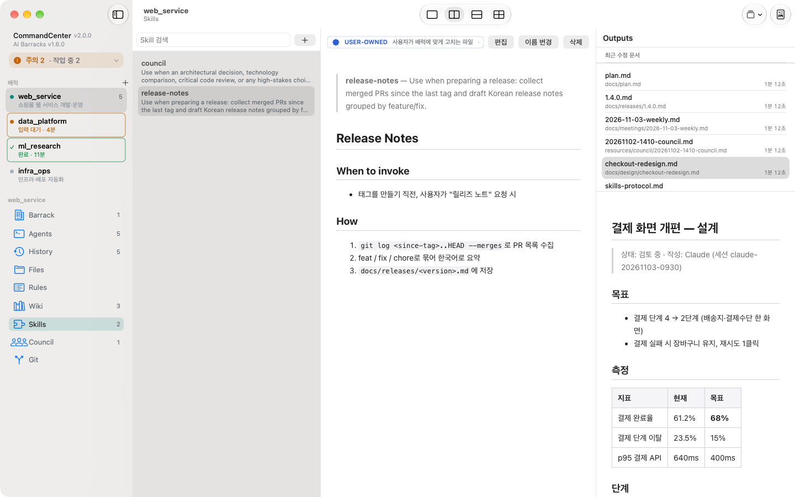 | 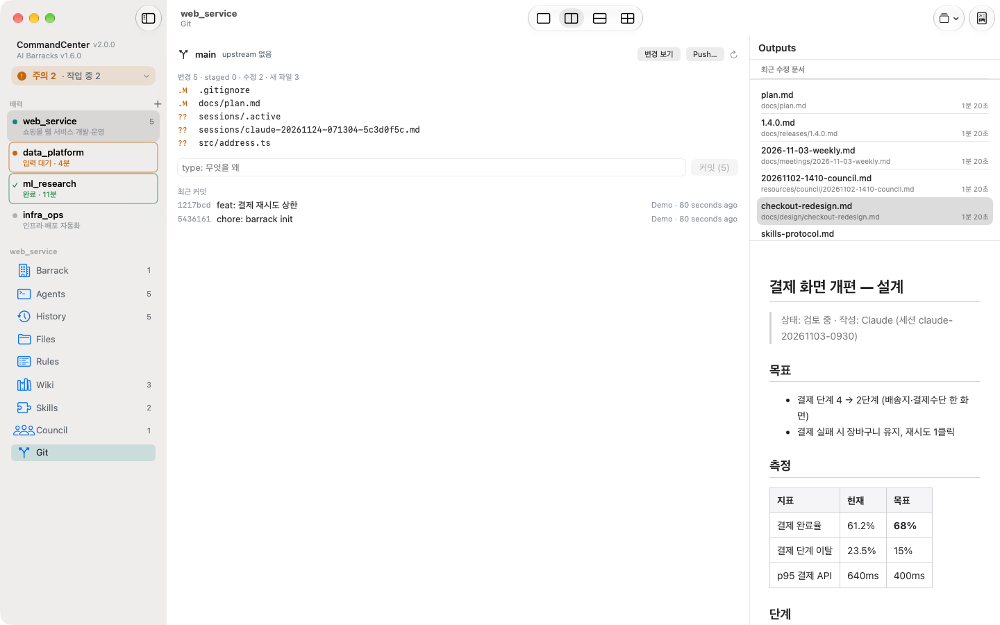 |

- **Wiki**: Index.md의 토픽·요약·갱신일 순서대로 보여 주고, 아래에 최근 변경을 보여 줍니다. 본문은 렌더링해서 읽습니다.
- **Council**: 여러 LLM이 한 주제를 토론하게 하고(`aib council`, ⌘⇧C), 의사록을 읽습니다.
- **Skills**: `skills/<slug>/SKILL.md` 카탈로그입니다. frontmatter 폼과 본문 에디터로 만들고, 고치고, 이름을 바꾸고, 지웁니다([편집 화면](docs/screenshots/14-skill-editor.png)). 저장하면 `aib sync`가 Claude·Codex 연결을 다시 만듭니다. 형식이 깨진 스킬에는 경고가 붙습니다.
- **Git**: 브랜치, 변경 파일, 최근 커밋을 봅니다. 배럭이 저장소의 하위 폴더여도 **배럭 경로만** 보여 주고 커밋·push합니다.

### ⚙️ 그 밖에

| 새 에이전트(⌘N) | 배럭 추가 |
|---|---|
| 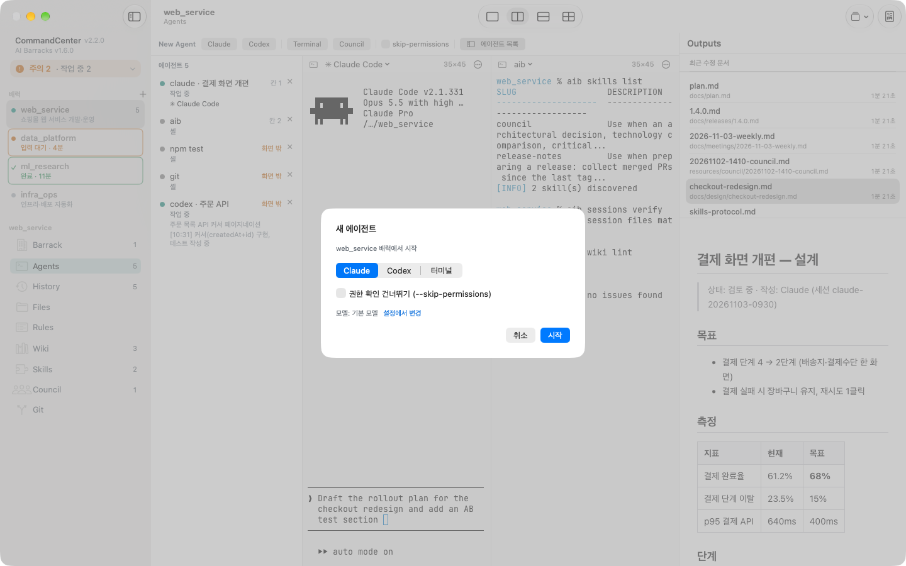 | 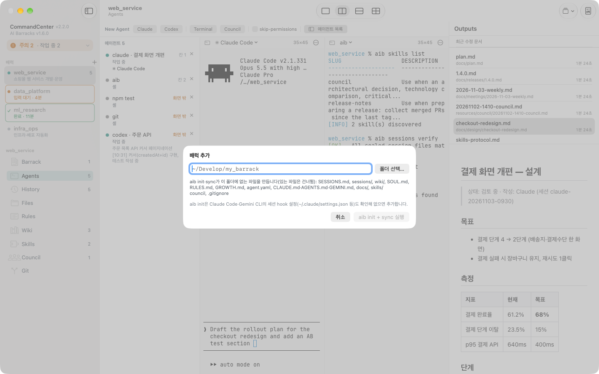 |
| **다크 모드** | **설정** |
| 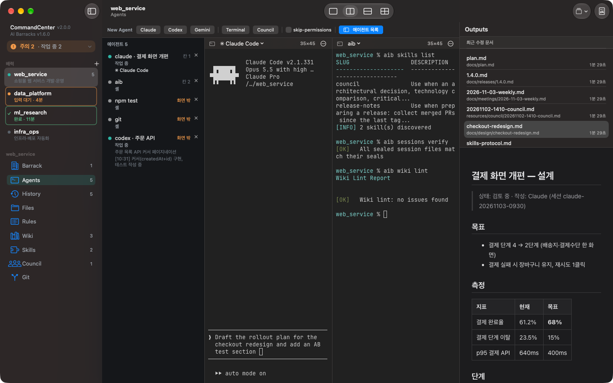 | 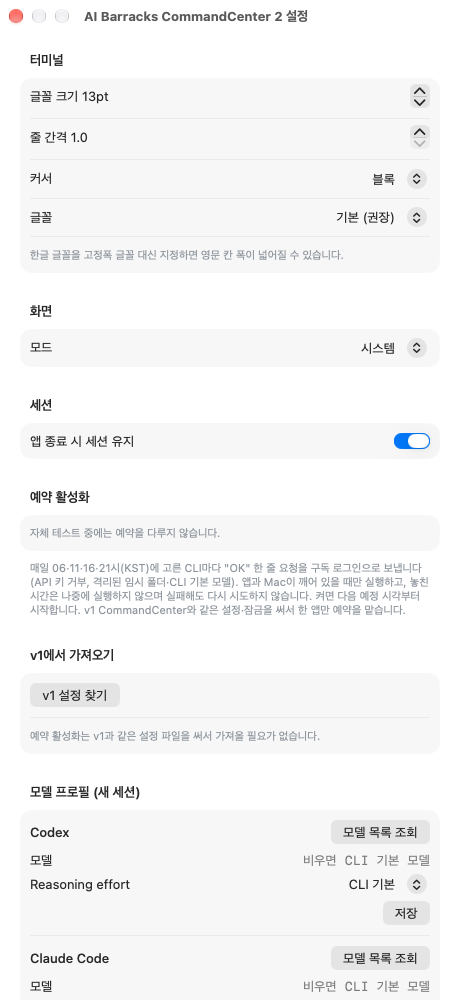 |

- **배럭 추가·제거**: 폴더를 고르면 `aib init`과 `aib sync`로 배럭을 만들고 등록합니다.
- **모델 프로필**: Claude·Codex별 모델과 추론 강도를 저장해 새 세션에 적용합니다.
- **Quick Command**: 자주 쓰는 명령을 이름·폴더와 함께 저장해 새 터미널에서 실행합니다.
- **예약 활성화**: 정해진 시각에 짧은 요청을 보내는 기능입니다(기본 꺼짐, 켜기 전에 비용 고지). v1과 같은 파일·잠금을 써서 두 앱이 함께 켜져 있어도 한 번만 실행됩니다.
- **v1 설정 가져오기**: v1의 Quick Command, 터미널 글꼴·커서·줄 간격, 모델 프로필을 읽어 옵니다(v1 파일은 건드리지 않음).
- 라이트/다크 모드([Barrack 다크](docs/screenshots/19-barrack-dark.png)), 메뉴 막대 아이콘, 터미널 글꼴·크기·줄 간격·커서 설정.

---

## 🚀 설치

**요구 사항**

- Apple Silicon Mac, macOS 14 이상
- [`aib`](https://github.com/ai-barracks/ai-barracks) CLI 1.6.0 이상과 등록된 배럭 하나 이상
  ```bash
  brew tap ai-barracks/ai-barracks
  brew install ai-barracks/ai-barracks/ai-barracks
  cd ~/my-project && aib init
  ```
- 쓰려는 에이전트 CLI(Claude Code · Codex 중 쓰는 것만)가 로그인 셸 PATH에 있을 것
- **Gemini는 2.0에서 뺐습니다.** Google이 2026-06-18부터 개인 계정(무료·AI Pro·Ultra)의 Gemini CLI를 [Antigravity CLI로 전환](https://developers.googleblog.com/an-important-update-transitioning-gemini-cli-to-antigravity-cli/)했기 때문입니다. 전에 기록된 Gemini 세션은 History에서 그대로 보고 Claude·Codex로 이어받을 수 있고, 업데이트 전에 띄워 둔 Gemini 터미널도 그대로 복원됩니다.

**설치**

1. [Releases](https://github.com/ai-barracks/ai-barracks-cc/releases)에서 `AI-Barracks-CommandCenter-<버전>.dmg`를 받아 `SHA256SUMS`와 대조합니다.
2. DMG를 열어 앱을 `/Applications`로 끌어 놓습니다.
3. ad-hoc 서명(Apple 공증 없음)이라 처음 한 번은 격리 속성을 지웁니다.
   ```bash
   xattr -cr "/Applications/AI Barracks CommandCenter 2.app"
   ```

앱을 열면 `~/.aib/barracks.json`에 등록된 배럭이 사이드바에 나타납니다.

**v1과 함께 쓰기**: v2는 번들 ID가 달라(`com.aibarracks.commandcenter2`) v1 옆에 나란히 설치되고, 설정과 터미널 세션이 섞이지 않습니다. 같은 배럭 문서를 두 앱에서 동시에 편집하지는 마세요. 데이터 위치와 제거 방법은 [docs/INSTALL.md](docs/INSTALL.md)에 있습니다.

> **처음 Claude Code를 띄우는 폴더**에서는 Claude가 폴더를 신뢰할지 묻습니다. 앱 안 터미널에서 그대로 답하면 됩니다.

---

## 🏗️ 구조

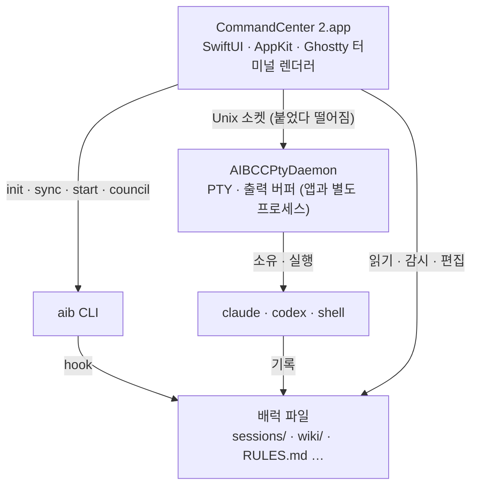

- **앱**: SwiftUI + AppKit. 터미널은 libghostty(Ghostty의 터미널 엔진)로 그립니다.
- **PTY 데몬**: 터미널 프로세스를 소유하고 출력을 버퍼링합니다. 앱은 소켓으로 붙었다 떨어질 뿐이라, 앱이 재시작해도 에이전트는 멈추지 않습니다. 열린 터미널이 없으면 5분 뒤 스스로 꺼집니다.
- **배럭 파일이 기준**: 앱은 자체 DB 없이 배럭 파일을 읽고, 바뀌면 다시 읽습니다. 상태를 바꾸는 작업은 `aib`에 맡깁니다.

---

## 🛠️ 소스에서 빌드

Xcode 없이 Command Line Tools만으로 빌드합니다.

```bash
git clone -b v2 https://github.com/ai-barracks/ai-barracks-cc.git
cd ai-barracks-cc
VERSION_LABEL=2.0.0 VARIANT=release ./scripts/package-app.sh   # dist/release/AI Barracks CommandCenter 2.app
./scripts/make-dmg.sh                                          # DMG + SHA-256
```

- 자체 테스트(`--selftest`), PTY 데몬 smoke, 앱 재실행 세션 유지 테스트, 판정 기준: [docs/DEVELOPMENT.md](docs/DEVELOPMENT.md)
- 릴리스 절차와 버전별 검증 기록: [docs/RELEASE.md](docs/RELEASE.md), 변경 내역: [CHANGELOG.md](CHANGELOG.md)
- 이 README의 화면 다시 찍기: `scripts/make-demo.sh`로 데모 배럭을 만들고, 앱을 `AIB_REGISTRY=/tmp/aibcc-demo/barracks.json`과 `--selftest-only=showcase`로 실행(`scripts/capture-watcher.sh`를 함께 실행)한 뒤 `scripts/showcase-compose.py <실행 폴더>`

## ⚠️ 알려진 제한

- Apple 공증이 없는 ad-hoc 서명입니다(위 `xattr` 단계 필요). arm64 빌드만 배포합니다.
- v1에서 일부만 옮긴 것([docs/PARITY.md](docs/PARITY.md) P06~P08): 실행 중 출력은 데몬 메모리에만 있고 터미널을 닫거나 프로그램이 끝날 때 보관됩니다(v1은 약 1초마다 디스크에 저장). 보관한 출력은 텍스트로만 다시 보고(색 재현 없음), 보관된 터미널의 폴더에서 새 셸을 바로 열 수 없습니다. v1 설정은 Quick Command·글꼴 크기·줄 간격·커서·모델 프로필만 가져오고, 글꼴 이름·테마·터미널 목록·v1 보관 기록은 가져오지 않습니다.
- 터미널을 넓혀도 Claude·Codex가 이미 출력한 대화는 그때 폭으로 줄바꿈된 채 남습니다.
- 그 밖의 항목은 [docs/known-issues.md](docs/known-issues.md)에 있습니다.

## 🔗 관련 프로젝트

| 프로젝트 | 역할 |
|---|---|
| [ai-barracks](https://github.com/ai-barracks/ai-barracks) | AI Barracks CLI(`aib`): 엔진, 이 앱의 전제 조건 |
| [Ghostty](https://github.com/ghostty-org/ghostty) · [libghostty-spm](https://github.com/Lakr233/libghostty-spm) | 터미널 엔진과 Swift 패키지 |
| [open-gitagent](https://github.com/open-gitagent/gitagent) | 호환되는 에이전트 정체성 표준 |

## 📜 License

[MIT](https://opensource.org/license/mit)

<div align="center">

**Your barracks deserve a cockpit.**
*배럭에는 조종석이 필요합니다.*

[🐛 버그 제보](https://github.com/ai-barracks/ai-barracks-cc/issues) · [🏰 AI Barracks CLI](https://github.com/ai-barracks/ai-barracks)

</div>
